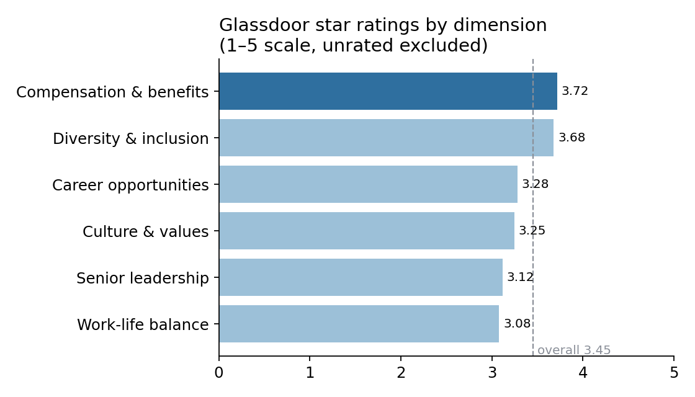
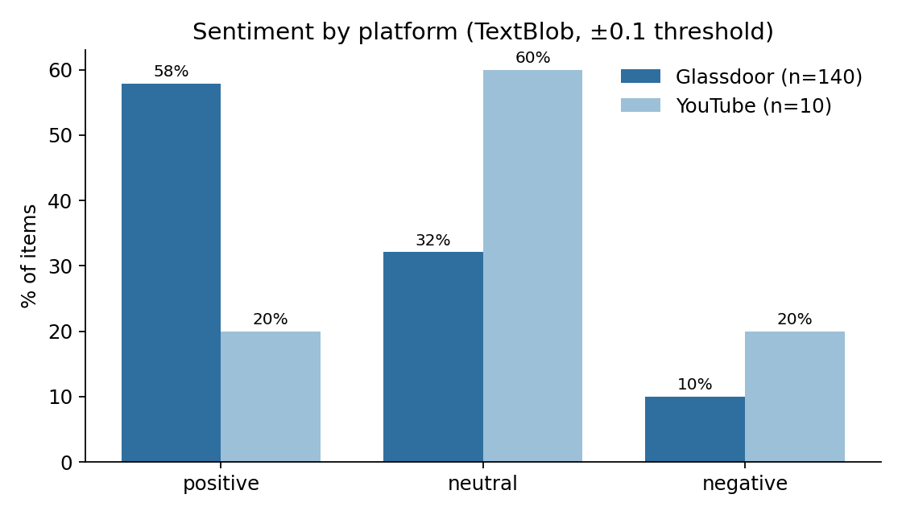
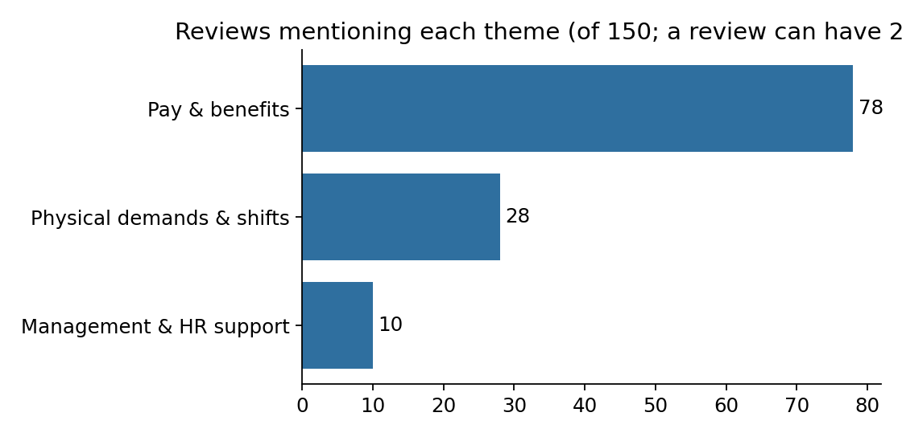
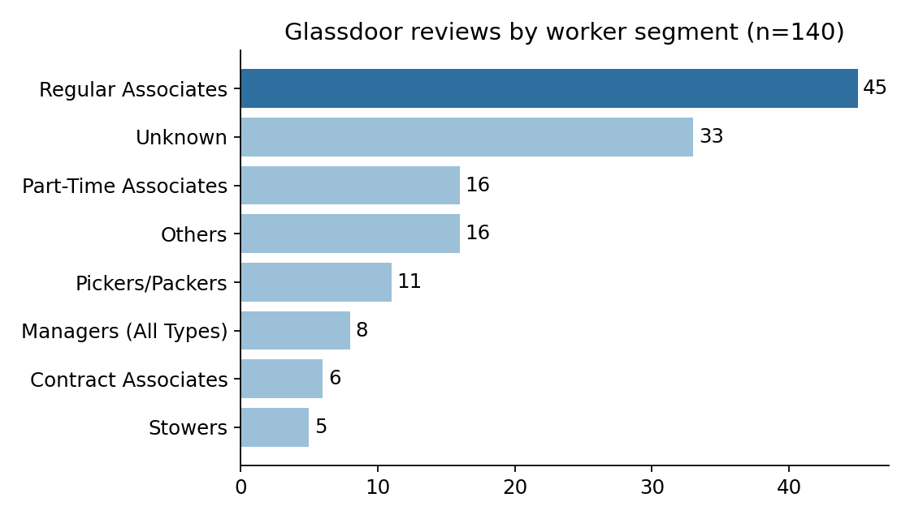

# Amazon Fulfillment Center Employee Voice Analysis

What do fulfillment-center (FC) associates say about their work, and where should a retention effort start?

---

# 1. Background and Overview

**Context.** I did this project as a virtual externship (Extern, Amazon-themed program), working as an analyst
for FC managers. The brief said associate turnover is about **150% a year**. That number was given to me. It is
not calculated from the data in this project. This is an independent portfolio project, not affiliated with
or endorsed by Amazon.

**Question.** What workplace experiences influence whether FC employees stay or leave?

**Method in one line.** Sentiment analysis, word-frequency analysis and theme tagging on 150 public employee
comments, then a pilot proposal.

Insights are grouped into four areas:

- **Mood:** how positive or negative are employees overall?
- **Ratings:** what do Glassdoor star ratings say about pay, work-life balance and leadership?
- **Shifts and physical work:** what do people complain about most?
- **Who is speaking:** which worker groups are in the data?

**AI use.** AI tools helped with code and drafting. See [Assumptions and Caveats](#6-assumptions-and-caveats).

---

# 2. Data Structure Overview

| Source | Items | Used for |
|---|---|---|
| Glassdoor reviews (Amazon FC roles) | **140** | Sentiment, themes, segments, star ratings |
| YouTube vlog transcripts | **10** | Sentiment, themes |
| **Total** | **150** | |

**Main fields:** review text (summary, pros, cons, advice), star ratings (overall, pay, work-life, leadership,
culture, career, diversity), job title, employment status.

**Added by me:** `sentiment_label` (positive / neutral / negative), `Theme` (3 themes) and `Segment` (worker group).

**Pipeline:**

```
raw text → clean → TextBlob sentiment → word counts → theme tags → segment tags → recommendation
```

**Checks done**

- Item counts confirmed: 140 Glassdoor + 10 YouTube = 150.
- Sentiment recomputed from the cleaned text and matches every stored label.
- Glassdoor stores "not rated" as **0** in sub-ratings. I excluded these. Without this, work-life would show 2.1
  instead of 3.1.
- `src/verify.py` runs 27 checks on the numbers in this README. All pass.

Raw review text is not published (third-party content). Summary tables are in [`data/aggregated/`](data/aggregated/).
Details are in [`data/README.md`](data/README.md).

---

# 3. Executive Summary

### Overview of Findings

1. **Employees are mostly positive, and pay is the main reason.** Pay and benefits is the top-rated area
   (3.72 out of 5).
2. **Work-life balance and leadership are the weakest areas** (about 3.1 out of 5).
3. **Long shifts and physical demands are the clearest complaint.** I recommend a small, low-risk pilot on
   scheduling.

Scheduling is *not* proven to be the main cause of turnover. The data cannot show that. It is the most concrete
and cheapest problem to test.



---

# 4. Insights Deep Dive

### Mood

* **Most Glassdoor reviews are positive.** 58% positive, 32% neutral, 10% negative (140 reviews).
* **YouTube looks less positive.** 20% positive, 60% neutral, 20% negative. This is only **10 videos**, so treat it as
  a hint, not a result.
* **The result is stable.** Re-scoring the raw text (keeping words like "not") moved positives from 58% to 62%.
  90% of labels did not change.



### Ratings

* **Pay leads.** Compensation and benefits: 3.72. Only 15% of raters gave 1–2 stars.
* **Work-life is lowest.** 3.08. 34% of raters gave 1–2 stars.
* **Leadership, culture and career opportunities sit close together** (3.12 to 3.28). With about 85 raters each,
  the gaps between them are small, so I treat them as one group of weaker areas.
* **Overall rating:** 3.45.

### Shifts and Physical Work

* **Pay is mentioned most.** 78 of 150 items (52%). 49 of them are positive.
* **Physical demands and shifts come next.** 28 items (19%). Their tone is mixed: 12 positive, 14 neutral, 2 negative.
* **Management and HR support:** 10 items (7%).
* **Common words:** "good pay" (18), "good benefits" (12), "physically demanding" (7), "use break time" (3),
  "work life balance" (3).
* **People often praise pay and describe hard work in the same breath.**

> *"Long hours, minimal light, … mandatory overtime with little to no heads up."* (public Glassdoor review)
> *"10-hour shifts and have to deal with heat and rain."* (public Glassdoor review)



Word charts: [`figures/ngrams/`](figures/ngrams/).

### Who Is Speaking

* **Regular associates are the biggest group:** 45 of 140 Glassdoor reviews (32%).
* They work with every other role (stowers, pickers, packers, learning ambassadors, area managers), so changes to
  their schedules reach the whole floor. That is why they are the pilot group.
* YouTube has no role information, so this view is Glassdoor only.



---

# 5. Recommendations

**Pilot a Scheduling Risk dashboard for four weeks in one FC.**

| | |
|---|---|
| **What** | Extend an existing workforce-management system or a Power BI / Excel dashboard. It flags overtime, back-to-back long shifts, uneven workloads and last-minute schedule changes. It alerts area managers **before** schedules are final. |
| **Who** | Area managers act on alerts. Learning Ambassadors collect weekly associate feedback. A project lead reports and recommends. |
| **Group** | Regular associates in one FC. |

| Week | Activity |
|---|---|
| 0 | Set up the dashboard. Brief Learning Ambassadors. |
| 1–4 | Managers act on alerts. Associates give weekly feedback. |
| 5 | Review results and decide. |

**Success targets**

- At least **20% fewer high-risk schedules** reaching final.
- At least **50% positive** weekly associate feedback.
- Managers use the dashboard every week (logged check-ins).

**Decision after week 5:** targets met → expand to more FCs. Partly met → extend 2–4 weeks with changes.
Not met → rethink the tool before any rollout.

**Why start here:** Work-life balance is the lowest-rated area, long shifts are the most concrete complaint, and a
dashboard is cheap and safe to test.

*This is a proposal. It was not run, and there are no impact results.*

**Next steps for the analysis**

1. Write the theme and segment rules in code so labels can be reproduced.
2. Ask a second person to label a sample and check agreement.
3. Test a multilingual or transformer sentiment model.
4. Collect more videos and reviews to test the YouTube vs Glassdoor difference.
5. Run the pilot and measure.

---

# 6. Assumptions and Caveats

* **Small, non-random samples.** 140 reviews and 10 videos. People who post reviews may not represent all staff.
* **Turnover is not measured.** Nothing here links comments to who actually left. The 150% figure is external.
* **"Primary driver" is not proven.** Pay is mentioned most. Scheduling is chosen because it is concrete and
  testable, not because the data proves it is the top cause.
* **Themes are loose.** The pay theme keywords include "balance", "opportunity" and "growth", so it is broader than
  pay. 61 of 150 items (41%) have no theme.
* **Themes and segments were labelled by hand.** A keyword pass came first, then manual edits that were not
  logged. The keyword code alone reproduces about 69% of the final themes. Segments came from job title and
  employment status.
* **Lexicon sentiment.** TextBlob can miss sarcasm and context. It reads English only: at least 4 Glassdoor
  reviews are in Spanish (some with garbled accents), so their labels are unreliable (about 3% of reviews).
* **YouTube comparison.** 10 videos is too few for firm conclusions.
* **Root-cause tree** ([`figures/hypothesis/`](figures/hypothesis/)) shows ideas on why long shifts exist (rate
  pressure, site design, shift policy, incentives). It is a **hypothesis from outside context, not a result of this
  data.**
* **AI assistance.**

  | Part | Tool | What I did |
  |---|---|---|
  | Research questions | ChatGPT | Drafted five questions. I merged them with mine into one guiding question. |
  | Original notebook code | AI assistants, mainly ChatGPT | Most code was AI-generated. I ran it on my data, set the thresholds and assembled the pipeline. |
  | Themes and segments | Manual, with a keyword first pass | Edits not logged. |
  | `src/analysis.py`, `src/verify.py`, summary tables, README | Claude (Anthropic) | Drafted from my notebooks, data and notes. Also audited the notebooks. |
  | Interpretation and recommendation | Me | I can explain every method and number here. |

---

### Project files

```
src/analysis.py          builds the charts and summary tables
src/verify.py            checks the numbers in this README against the data (27 checks)
figures/                 charts (ngrams/ and hypothesis/ subfolders)
data/aggregated/         summary tables behind the charts
notebooks/original/      original Colab notebooks (archived, with known issues listed)
```

To reproduce: `pip install -r requirements.txt`, then

```
python src/analysis.py  your_labelled_file.csv
python src/verify.py    your_labelled_file.csv  your_raw_glassdoor_file.csv
```

**Author:** Sayed Ali Shahin
